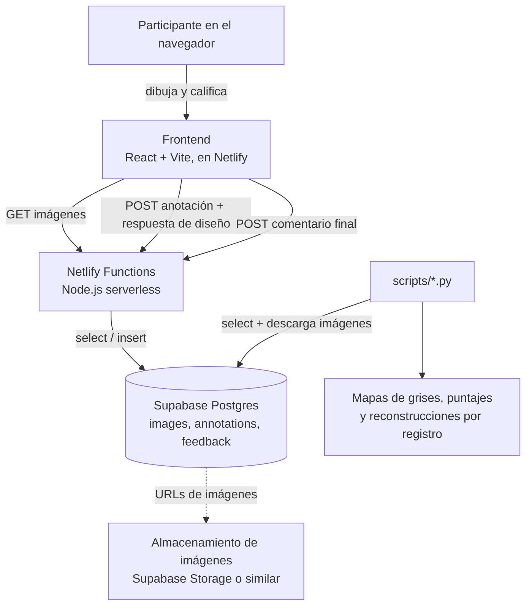

# Saliency — Estudio de atención visual en anuncios

Sitio web para estudios de atención visual. A cada participante se le muestra
una serie de imágenes publicitarias, una por una:

1. **Marca con un pincel** las zonas que llaman su atención de forma espontánea.
2. **Califica el diseño** de la imagen completa: *Sí*, *No* o *No puedo determinarlo*.

Cada persona ingresa con su **correo electrónico** (sin verificación), lo que le
permite **pausar y continuar después** desde donde quedó. Al final puede dejar un
**comentario opcional**. Con esos datos se construyen mapas de grises de atención
y puntajes de diseño por imagen.

## 1. Arquitectura



- **Frontend**: React + Vite + Tailwind, dividido en `src/` por pantallas, componentes y utilidades.
- **Backend**: Netlify Functions (`netlify/functions/`), sin servidor propio que mantener. Validan todo lo que reciben antes de escribir en la base.
- **Base de datos**: Supabase (Postgres) con tres tablas: `images` (catálogo), `annotations` (una fila por participante e imagen) y `feedback` (un comentario por participante).
- **Análisis**: scripts de Python en `scripts/`, independientes del sitio, que se conectan directamente a Supabase.

## 2. Estructura del repositorio

```
src/
  App.tsx                    -- máquina de estados de la encuesta (qué pantalla toca)
  content.ts                 -- TODO el texto visible para el participante
  privacy.ts                 -- responsable, contacto y versión del aviso de tratamiento de datos
  index.css                  -- estilos globales, variables de color y variantes de diseño
  main.tsx                   -- punto de entrada de React
  lib/
    types.ts                 -- tipos (Stroke, ImageItem, Screen…)
    api.ts                   -- llamadas a las funciones de Netlify
    session.ts               -- sessionStorage: solo el participantId (recargar sin pedir el correo)
    email.ts                 -- normalización y validación básica del correo
    strokes.ts               -- recorte y redondeo de los trazos antes de enviarlos
  components/
    AnnotationCanvas.tsx     -- lienzo de dibujo sobre la imagen
    Icons.tsx, StatusScreens.tsx
  screens/
    IntroScreen.tsx          -- instrucciones, aviso de pausa y de tratamiento de datos
    EmailScreen.tsx          -- correo (con confirmación) y resumen "Continúa en la imagen X de N"
    AnnotationScreen.tsx     -- dibujo (pincel, borrador, deshacer, instrucciones)
    RatingScreen.tsx         -- calificación del diseño (Sí / No / No puedo determinarlo)
    PauseScreen.tsx          -- participación en pausa: avance y cómo volver
    TransitionScreen.tsx     -- pausa breve entre imágenes
    CommentScreen.tsx        -- comentario final opcional
    CompleteScreen.tsx       -- agradecimiento
netlify/functions/
  annotations.ts             -- POST: valida y guarda una anotación (idempotente)
  feedback.ts                -- POST: guarda el comentario final
  images.ts                  -- GET: devuelve la lista de imágenes activas
  participants.ts            -- POST: registra/identifica al participante (correo + autorización),
                                devuelve su orden de imágenes y su progreso
  complete.ts                -- POST: marca la encuesta del participante como completada
netlify/lib/shared.ts        -- cliente de Supabase y utilidades compartidas por las funciones
netlify.toml                 -- configuración de build y de netlify dev
check-privacy.mjs            -- el build de producción falla si el aviso de datos está incompleto
supabase/migrations/
  001_design_answer_feedback.sql  -- columna design_answer y tabla feedback
  002_participants.sql            -- tabla participants (correo, orden, autorización) y vínculos
scripts/
  generar_mapas_calor.py             -- mapa de grises promedio por imagen
  generar_puntajes.py                -- puntaje de diseño por imagen (CSV)
  generar_dibujos_por_registro.py    -- una imagen por cada anotación guardada
  generar_dibujos_por_participante.py -- igual, nombrado por participante
  supabase_utils.py                  -- lectura paginada de Supabase (compartida)
  test_mapas_grises.py, test_puntajes.py -- pruebas con datos sintéticos
  requirements.txt                   -- dependencias de Python
```

## 3. Flujo del participante

1. **Intro**: instrucciones (Texto 1), aviso de que puede pausar y continuar con el mismo correo, aviso de tratamiento de datos y *Comenzar*.
2. **Correo**: escribe su correo electrónico y lo confirma ("Se usará este correo: …"). Se normaliza (se recorta y pasa a minúsculas) y se valida su formato; **no se verifica** que exista. Si ya tenía avance, ve un resumen ("Continúa en la imagen X de N") antes de seguir.
3. **Dibujo**: sobre cada imagen marca con el pincel lo que llama su atención. Puede borrar, deshacer o limpiar, y volver a leer las instrucciones con *Ver instrucciones*. *Siguiente* se habilita solo cuando hay al menos un trazo de pincel. Solo se puede dibujar sobre la imagen, no sobre las franjas vacías.
4. **Calificación**: ve la imagen sin trazos, lee el Texto 2 y responde *Sí*, *No* o *No puedo determinarlo* (sin opción preseleccionada). Al pulsar *Continuar* se guarda **una sola vez** el dibujo y la respuesta. Si falla el guardado, se muestra el error y se puede reintentar sin perder nada.
5. Repite 3–4 para cada imagen pendiente (si una imagen no carga, puede saltarla).
6. **Comentario final** opcional (hasta 2000 caracteres). Al cerrarlo (enviado u omitido) la encuesta se marca como completada y aparece la **pantalla de agradecimiento**.

### Identificación, orden y progreso

- La persona se identifica **solo por correo**; no hay verificación, recordatorios ni inicio de sesión.
- **El servidor decide y guarda el orden** de las imágenes la primera vez que entra el correo. El navegador no mezcla nada: ordena el catálogo con el `order` que recibe. Al volver, el servidor lo reconcilia con las imágenes activas (descarta las que ya no existen y agrega al final las nuevas).
- **El progreso se deduce de las anotaciones guardadas**: la encuesta sigue en la primera imagen del orden que todavía no tiene anotación (`doneImageIds`). No hay un contador aparte. Si ya hizo todas pero no cerró, va al comentario; si ya cerró, ve la pantalla final.

### Pausa

Hay un botón **Pausar** en las pantallas de dibujo y de calificación. Si hay trazos o una calificación sin guardar, se pide confirmación avisando de que **esa imagen se repetirá** al volver (el dibujo en curso nunca se guarda). La pantalla de pausa muestra el avance (X de N) e indica volver a ingresar con el mismo correo; el progreso ya guardado queda en el servidor.

### Qué se guarda en el navegador

Solo el `participantId` (un UUID que entrega el servidor) en `sessionStorage`, clave `saliency:session:v2`. Sirve para que **recargar la pestaña no vuelva a pedir el correo**. Se borra al **pausar** y al **terminar**.

- Una pestaña nueva (o cerrar y volver) pide el correo de nuevo y retoma desde el servidor.
- Si el navegador bloquea `sessionStorage`, la encuesta funciona igual, pero cada recarga vuelve a pedir el correo.
- Si el servidor no reconoce el `participantId` guardado, se descarta y se vuelve a la intro.

### Contrato del frontend con el backend

Todo lo que el frontend espera del servidor está en [`src/lib/api.ts`](src/lib/api.ts):

- `POST /.netlify/functions/participants` con `{ email, consent: true, consentVersion }` (ingreso) o `{ participantId }` (recarga) responde `{ participantId, order, doneImageIds, completed }`: `order` son los ids de todas las imágenes activas en el orden de ese participante, `doneImageIds` los ids que ya tienen anotación y `completed` si ya cerró la encuesta. Un correo **nuevo** solo se registra si llega `consent: true` y la versión del aviso (la autorización de tratamiento de datos); un correo ya registrado no la vuelve a exigir. Responde 400 si el correo es inválido o falta la autorización, y 404 si el `participantId` no existe.
- `POST /.netlify/functions/complete` con `{ participantId }` marca la encuesta como completada.
- `annotations` y `feedback` siguen igual, pero solo aceptan participantes registrados (400 en caso contrario).

### Dónde están los textos

Todo el texto visible está en [`src/content.ts`](src/content.ts), en trato de **usted**. Los textos 1 (instrucciones) y 2 (calificación) son los oficiales del estudio: edítelos ahí y no en los componentes.

## 4. Requisitos previos

- Node.js (trae npm)
- `pnpm` como gestor de paquetes:
  ```
  corepack enable
  corepack prepare pnpm@latest --activate
  ```
- En Windows: activar el **Modo de desarrollador** (Configuración → Privacidad y seguridad → Para desarrolladores) — Netlify CLI necesita crear symlinks al empaquetar las funciones, y Windows lo bloquea por defecto sin esto.
- Una cuenta de [Supabase](https://supabase.com) (plan gratuito es suficiente) y una de [Netlify](https://netlify.com).
- Python 3 para los scripts de análisis.

## 5. Configuración local

1. Clona el repositorio e instala dependencias:
   ```
   git clone https://github.com/Menteenblanc0/Saliency.git
   cd Saliency
   pnpm install
   ```
   Si `pnpm` pregunta por scripts de instalación bloqueados, corre `pnpm approve-builds` y aprueba todos.

2. Instala Netlify CLI (si no lo tienes):
   ```
   pnpm add -D netlify-cli
   ```

3. Crea un archivo `.env` en la raíz del proyecto:
   ```
   SUPABASE_URL=https://tu-proyecto.supabase.co
   SUPABASE_SERVICE_ROLE_KEY=tu_service_role_key
   ```
   Ambos valores están en tu proyecto de Supabase: **Project Settings → API**. Usa la key `service_role` (secreta, con permisos totales), no la `anon`. Vive solo en las funciones del servidor, nunca en el frontend.

4. Corre el proyecto:
   ```
   pnpm exec netlify dev
   ```
   Esto levanta el frontend (Vite) y las funciones serverless juntas, normalmente en `http://localhost:8888`.

## 6. Base de datos (Supabase)

Corre esto en **Supabase → SQL Editor**. Es repetible: se puede correr de nuevo sin error.

```sql
-- 1) Esquema base
create extension if not exists pgcrypto;

create table if not exists images (
  id uuid primary key default gen_random_uuid(),
  url text not null,
  alt text,
  active boolean not null default true,
  created_at timestamptz not null default now()
);

create table if not exists annotations (
  id uuid primary key default gen_random_uuid(),
  participant_id uuid not null,
  image_id text not null,
  strokes jsonb not null,
  created_at timestamptz not null default now()
);

create index if not exists idx_annotations_image_id on annotations (image_id);
create unique index if not exists idx_annotations_unique_submission
  on annotations (participant_id, image_id);

-- 2) Migración 001: respuesta de diseño y comentario final
--    (el mismo contenido está en supabase/migrations/001_design_answer_feedback.sql)
alter table annotations
  add column if not exists design_answer text
  check (design_answer in ('si', 'no', 'no_determina'));

create table if not exists feedback (
  id uuid primary key default gen_random_uuid(),
  participant_id uuid not null,
  comment text not null,
  created_at timestamptz not null default now()
);

create unique index if not exists idx_feedback_participant
  on feedback (participant_id);

alter table feedback enable row level security;

-- 3) Migración 002: participantes identificados por correo, con autorización
--    (el mismo contenido está en supabase/migrations/002_participants.sql)
create table if not exists participants (
  id uuid primary key default gen_random_uuid(),
  email text not null check (email = lower(btrim(email)) and char_length(email) <= 254),
  image_order jsonb not null default '[]'::jsonb,
  consent_version text not null,
  consent_at timestamptz not null default now(),
  completed_at timestamptz,
  created_at timestamptz not null default now()
);

create unique index if not exists idx_participants_email on participants (email);
alter table participants enable row level security;

do $$
begin
  if not exists (select 1 from pg_constraint where conname = 'fk_annotations_participant') then
    alter table annotations add constraint fk_annotations_participant
      foreign key (participant_id) references participants (id) not valid;
  end if;
  if not exists (select 1 from pg_constraint where conname = 'fk_feedback_participant') then
    alter table feedback add constraint fk_feedback_participant
      foreign key (participant_id) references participants (id) not valid;
  end if;
end $$;
```

> **Las migraciones se corren ANTES de desplegar el código nuevo.** Sin la columna `design_answer`, la tabla `feedback` y la tabla `participants`, el sitio no funciona.

El **índice único** `idx_annotations_unique_submission` es el que hace idempotente el guardado: si un reintento llega dos veces, la segunda se trata como éxito en vez de duplicar la fila.

### Qué guarda cada tabla

- **`annotations`**: una fila por participante e imagen, con los trazos (`strokes`) y la respuesta de diseño en texto crudo (`design_answer`: `'si'`, `'no'` o `'no_determina'`). No hay escala numérica en la base: el paso a puntaje vive solo en `scripts/generar_puntajes.py`.
- **`feedback`**: el comentario final opcional, una fila por participante.
- **`participants`**: una fila por correo (normalizado). Guarda el orden de imágenes de esa persona (`image_order`, lo decide y reconcilia el servidor), la **prueba de la autorización** de tratamiento de datos (`consent_version` y `consent_at`) y si cerró la encuesta (`completed_at`). **El correo vive solo aquí**: `annotations` y `feedback` solo conocen el id aleatorio, y ningún script de análisis lee la tabla. El progreso no se guarda: se deduce de las filas de `annotations` de esa persona. `annotations` y `feedback` solo aceptan ids de participantes registrados.

### Formato de `strokes` (columna `jsonb`)

Un arreglo de trazos, en el orden real en que se dibujaron:

```json
[
  { "tool": "brush", "size": 0.02, "points": [{ "x": 0.51, "y": 0.30 }, ...] },
  { "tool": "eraser", "size": 0.03, "points": [...] }
]
```

`x` e `y` son la posición como **fracción del ancho y del alto de la imagen tal como se ve en pantalla** (0 = borde izquierdo/superior, 1 = borde derecho/inferior), y `size` es el grosor del pincel como fracción del ancho de la imagen. No dependen del lienzo ni del tamaño de la pantalla (la imagen puede verse con franjas vacías alrededor), así que los datos son comparables entre dispositivos.

**El orden de las zonas no importa**: solo cuenta lo que queda marcado al final. El mapa se obtiene reproduciendo los trazos en orden (el pincel pinta, el borrador quita). No hay un mapa de "primer trazo".

El servidor rechaza (400) anotaciones con: `participantId`/`imageId` que no sean UUID, una `imageId` que no exista en `images`, `designAnswer` fuera de las tres opciones, coordenadas fuera de [0, 1], `size` fuera de (0, 1], más de 300 trazos, más de 5000 puntos por trazo, o sin ningún trazo de pincel.

## 7. Cargar o reemplazar las imágenes del estudio

Sube tus imágenes a un bucket público de **Supabase Storage** (Storage → crea un bucket, ej. `study-images`, márcalo público), copia la URL pública de cada una, e insértalas:

```sql
insert into images (url, alt) values
  ('https://tu-proyecto.supabase.co/storage/v1/object/public/study-images/anuncio-01.jpg', 'Anuncio de zapatillas'),
  ('https://tu-proyecto.supabase.co/storage/v1/object/public/study-images/anuncio-02.jpg', 'Anuncio de bebida energética');
```

El sitio se adapta solo a cuántas imágenes haya (contador, barra de progreso, orden aleatorio por participante): no hay que tocar código sin importar si son 5 o 500. Solo se muestran las que tienen `active = true`.

## 8. Despliegue en Netlify

1. **Corre la migración en Supabase** (sección 6) si todavía no lo hiciste.
2. Sube tus cambios a GitHub (`git push`).
3. En [app.netlify.com](https://app.netlify.com): **Add new site → Import an existing project → GitHub** → selecciona el repositorio.
4. Netlify detecta `netlify.toml` automáticamente (build command `pnpm build`, publish `dist`, functions `netlify/functions`).
5. Antes o después del primer deploy, ve a **Site configuration → Environment variables** y agrega `SUPABASE_URL` y `SUPABASE_SERVICE_ROLE_KEY` con los mismos valores de tu `.env` local. Si las agregas después del primer deploy, tienes que forzar uno nuevo (**Deploys → Trigger deploy → Clear cache and deploy site**) para que se apliquen.
6. Prueba el flujo completo en la URL pública (ver la lista de verificación de la sección 11).

## 9. Scripts de análisis (`scripts/`)

Scripts de Python, independientes del sitio, que se conectan directamente a Supabase con la misma `service_role` key. Todos leen las tablas **por páginas de 1000** (Supabase trunca en silencio lo que pase de ese tope), así que funcionan con cualquier cantidad de participantes.

| Script | Qué genera |
|---|---|
| `generar_mapas_calor.py` | Un **mapa de grises** por imagen en `mapas_grises/{image_id}.png` (8 bits, mismo tamaño que la original, sin la imagen debajo) más `resumen.json`. Cada participante aporta una máscara con lo que dejó marcado; el valor de cada píxel es la fracción de participantes que lo marcaron × 255 (blanco = todos). Las imágenes sin anotaciones no generan PNG y quedan con `participantes: 0` en el resumen. Con `--overlay` genera además `mapas_calor/` con el mapa a color sobre la imagen. |
| `generar_puntajes.py` | `puntajes/puntajes_por_imagen.csv` con, por imagen: `image_id`, `url`, `alt`, `n`, `n_si`, `n_no`, `n_no_determina`, `puntaje_promedio`, `desviacion_estandar`. Incluye las imágenes sin respuestas (`n = 0`, puntajes vacíos). |
| `generar_dibujos_por_registro.py` | Una imagen por cada fila de `annotations`, mostrando exactamente lo que esa persona dibujó (nombrada por el id de la anotación). |
| `generar_dibujos_por_participante.py` | Igual que el anterior, pero el archivo se nombra `{participant_id}__{image_id}.png` para ubicar fácil todo lo que anotó una persona. |

**Puntaje de diseño.** El mapeo está en un diccionario al inicio de `generar_puntajes.py` (`PUNTAJE_POR_RESPUESTA`): `si = 1`, `no = 0`, `no_determina = 0.5`. El puntaje por imagen es el promedio simple de todas las respuestas (los 0.5 incluidos) y la desviación estándar es la **muestral** (n − 1; con una sola respuesta queda vacía). Para cambiar el mapeo se edita una línea; la base de datos guarda siempre el texto crudo.

Instalación y uso (igual para todos):
```
cd scripts
pip install -r requirements.txt
```
Crea un `.env` dentro de `scripts/` con las mismas dos variables de Supabase y corre el script que necesites (`python generar_mapas_calor.py`, `python generar_puntajes.py`, etc.). Cada uno crea su carpeta de salida junto al script. Las salidas contienen ids de participantes y están en `.gitignore`: no se suben al repositorio.

Pruebas (no necesitan Supabase ni internet): `python test_mapas_grises.py` y `python test_puntajes.py`.

## 10. Datos personales y privacidad

El único dato personal que se recolecta es el **correo electrónico**, más lo que la persona escriba en el comentario final. Está pensado para la Ley 1581 de 2012 (protección de datos personales, Colombia), que exige una autorización **previa, expresa e informada**, informar la finalidad, los derechos del titular y quién es el responsable, y **conservar prueba** de ello.

**Cómo está resuelto en el sitio**
- El aviso completo (responsable, datos, finalidad, carácter voluntario, derechos, conservación, mayoría de edad y almacenamiento en la nube) se muestra en la pantalla del correo, y una casilla **sin marcar de antemano** ("Soy mayor de 18 años, he leído el aviso… y autorizo…") es obligatoria para continuar. El texto está en `src/content.ts` (bloque `privacy`).
- La **prueba de la autorización** queda en `participants.consent_version` y `participants.consent_at`; el servidor no registra un correo nuevo sin ella.
- Se pide solo el correo (sin nombre) y no se piden datos sensibles. El correo está en una tabla aparte, con RLS y sin lectura desde el navegador, y los scripts de análisis usan solo el id aleatorio.

**Lo que hay que completar antes de abrir el estudio**
1. En [`src/privacy.ts`](src/privacy.ts), reemplazar los marcadores `[COMPLETAR…]` de `responsable` (quién trata los datos: universidad o grupo de investigación) y `contacto` (correo para consultas, reclamos y solicitudes). **El build de producción en Netlify falla mientras queden esos marcadores**, a propósito, para no publicar el aviso a medias.
2. Que el supervisor o la oficina jurídica de la institución **revise el texto** (finalidad, conservación, almacenamiento en servicios en la nube fuera de Colombia, menores de edad, política de tratamiento de información de la institución y si hay que registrar la base de datos en el RNBD). Si cambia el texto del aviso, cambiar también `PRIVACY.version`.
3. Tener un buzón atendido en el correo de contacto: es el canal para los derechos de las personas.

**Atender solicitudes de los titulares** (en Supabase → SQL Editor; reemplace el correo):

```sql
-- Prueba de la autorización (cuándo y con qué versión del aviso)
select email, consent_version, consent_at from participants where email = 'persona@correo.com';

-- Supresión total: se borra todo lo de esa persona (respuestas, comentario y correo). Irreversible.
delete from feedback where participant_id = (select id from participants where email = 'persona@correo.com');
delete from annotations where participant_id = (select id from participants where email = 'persona@correo.com');
delete from participants where email = 'persona@correo.com';

-- Desvincular el correo y conservar sus respuestas sin identificarla
update participants set email = 'eliminado-' || id::text || '@invalid.local' where email = 'persona@correo.com';
```

**Al terminar el estudio**, para desvincular a todas las personas de sus respuestas (según lo que diga el aviso): `update participants set email = 'eliminado-' || id::text || '@invalid.local';`

**Limitación conocida**: el correo no se verifica. Quien conozca el correo de otra persona puede ingresar con él, continuar su progreso y responder en su nombre. Si el estudio lo necesita, la verificación (enlace o código por correo) es un cambio aparte.

## 11. Lista de verificación antes de abrir el estudio

1. **Migraciones 001 y 002 corridas en Supabase antes del despliegue** (sección 6). Compruébelo:
   ```sql
   select 'columna design_answer' as revision, count(*)::text as resultado
     from information_schema.columns
     where table_name = 'annotations' and column_name = 'design_answer'
   union all
   select 'indice: ' || indexname, 'ok'
     from pg_indexes where tablename in ('annotations', 'feedback', 'participants')
   union all
   select 'vinculo: ' || conname, 'ok'
     from pg_constraint where conname in ('fk_annotations_participant', 'fk_feedback_participant')
   union all
   select 'tabla feedback', coalesce(to_regclass('public.feedback')::text, 'NO existe')
   union all
   select 'tabla participants', coalesce(to_regclass('public.participants')::text, 'NO existe');
   ```
   Debe aparecer `design_answer = 1`, `idx_annotations_unique_submission`, `idx_feedback_participant`, `idx_participants_email`, los dos vínculos y las tablas `feedback` y `participants`. Y la tabla `images` debe tener filas con `active = true`.
1b. **Aviso de datos completo** (sección 10): `responsable` y `contacto` en `src/privacy.ts`, texto revisado por el supervisor y buzón de contacto atendido.
2. **Desplegado en Netlify** y probado en la URL pública, en un **teléfono real** (vertical y horizontal), con las variables de entorno puestas.
3. **Un participante de prueba** entra con un correo, completa 3 o 4 imágenes, **recarga la pestaña** (no debe pedir el correo), **pausa, cierra el navegador por completo y vuelve a ingresar con el mismo correo** (debe continuar en la primera imagen pendiente, con el mismo orden), termina y deja un comentario.
4. **Se confirman las filas en Supabase**:
   ```sql
   select image_id, design_answer, jsonb_array_length(strokes) as trazos from annotations order by created_at;
   select * from feedback;
   select consent_version, consent_at, completed_at, jsonb_array_length(image_order) as imagenes from participants;
   ```
5. **Corren los scripts de mapas y de puntajes** con esos datos y los resultados tienen sentido (el mapa de grises coincide con lo dibujado; el puntaje con lo respondido).
6. **Se borran los datos de prueba antes de abrir el estudio real** (irreversible; no toca el catálogo `images`):
   ```sql
   truncate table annotations, feedback, participants;
   ```
   Cierre también la pestaña de prueba: su `sessionStorage` conserva el `participantId` del participante de prueba, que dejaría de existir en la base.
